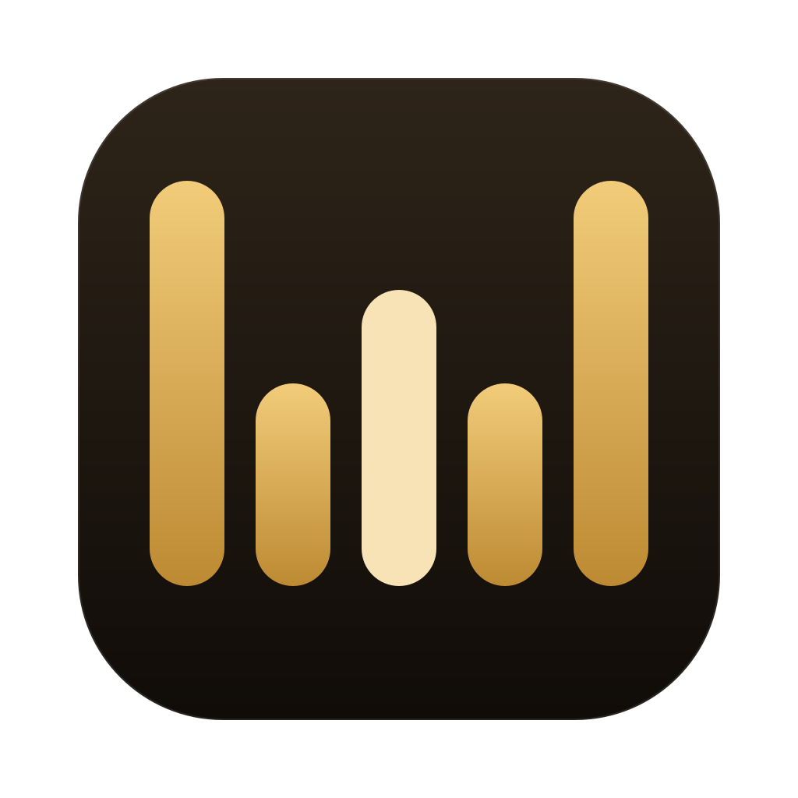
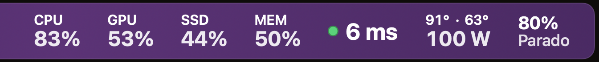
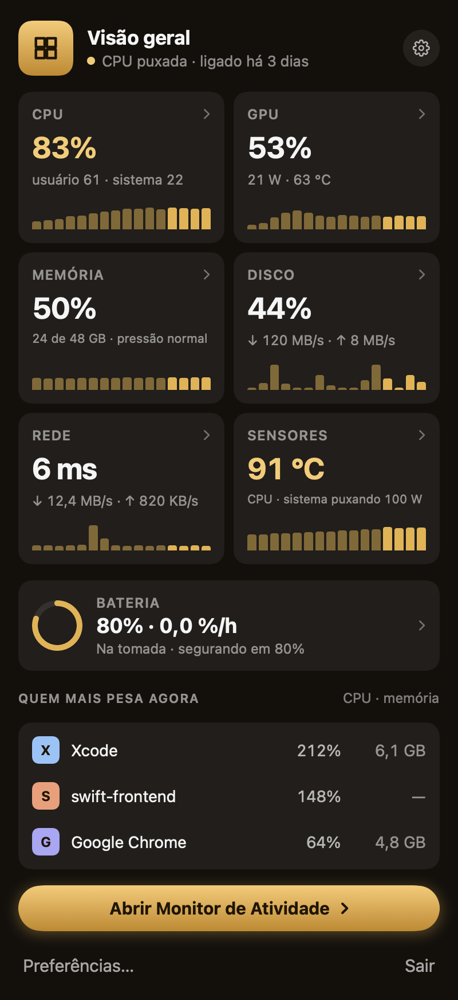
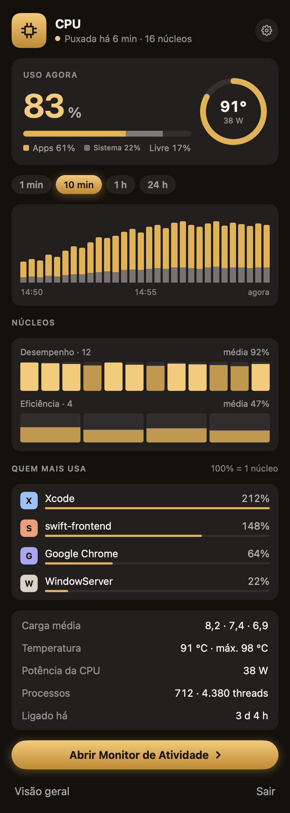
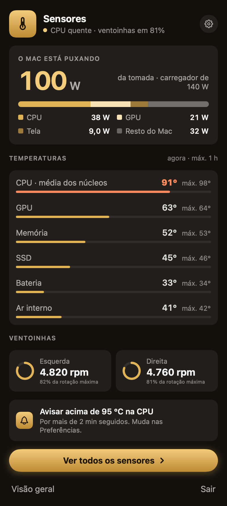
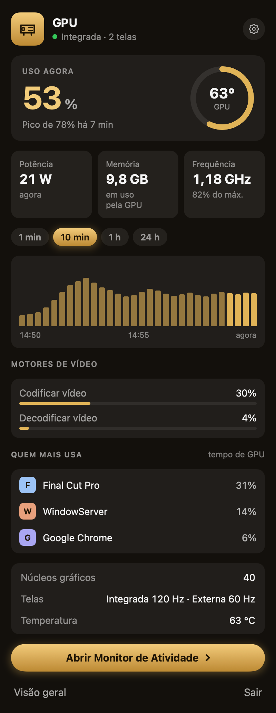
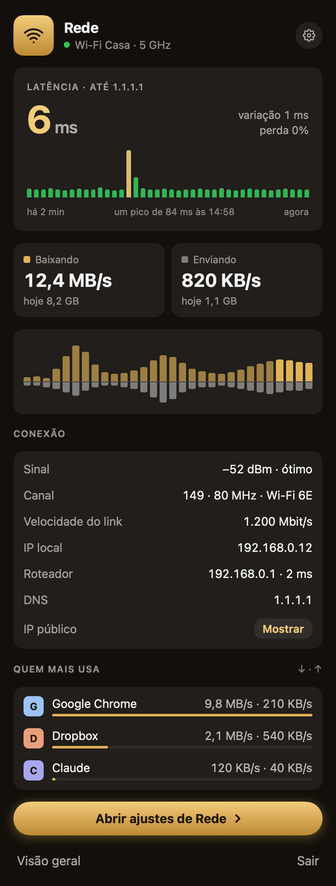
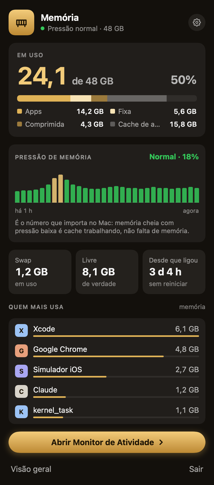
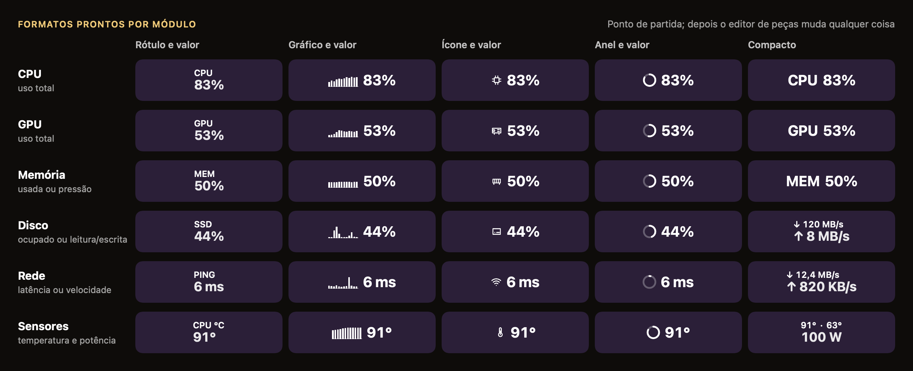
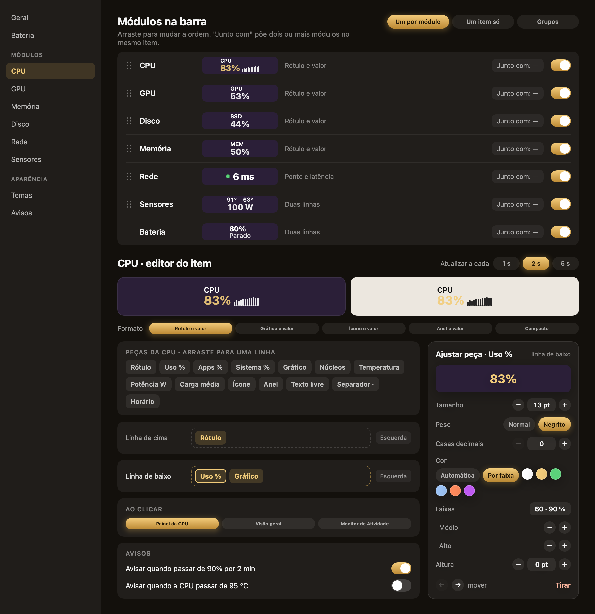

<p align="center">
  
</p>

<h1 align="center">My Stats</h1>

<p align="center">
  Bateria em %/h, CPU, GPU, memória, disco, rede e sensores na barra de menus do Mac.<br>
  Cada item da barra é montado peça por peça, do seu jeito.
</p>

<p align="center">
  <a href="https://github.com/edufigueiredos/my-stats/releases/latest"></a>
  
  <a href="LICENSE"></a>
</p>

<p align="center">
  <a href="https://github.com/edufigueiredos/my-stats/releases/latest"><b>Baixar a última versão</b></a>
</p>

<p align="center">
  
</p>

## Um clique em qualquer item abre o painel

<table>
  <tr>
    <td align="center" width="33%"><br><sub>Visão geral</sub></td>
    <td align="center" width="33%"><br><sub>CPU</sub></td>
    <td align="center" width="33%"><br><sub>Sensores</sub></td>
  </tr>
  <tr>
    <td align="center"><br><sub>GPU</sub></td>
    <td align="center"><br><sub>Rede</sub></td>
    <td align="center"><br><sub>Memória</sub></td>
  </tr>
</table>

## Do seu jeito

Cinco formatos prontos por módulo, e um editor de peças para montar o resto: rótulo, valor, gráfico, anel, ícone, temperatura, potência, texto livre, cor por faixa, uma ou duas linhas. Os módulos podem ficar um por item, todos num item só ou em grupos.

<p align="center"></p>
<p align="center"></p>

## Destaques

- **Bateria em %/h**: quanto o Mac gasta por hora, tempo até acabar ou encher, quem mais gasta, saúde, modo de energia e consumo de cada porta USB-C.
- **CPU e GPU**: uso por núcleo, frequência e tempo ligada da GPU, temperatura e os processos que mais pesam.
- **Memória e disco**: pressão, swap, espaço livre e velocidade de leitura e gravação.
- **Rede**: velocidade, latência até 1.1.1.1 com histórico, dados do Wi-Fi e quem mais usa a rede.
- **Sensores**: temperaturas, ventoinhas (rpm ou %) e quanto o Mac puxa da tomada.
- **Avisos** por notificação, **6 temas** e histórico de 90 dias da bateria.
- Tudo sem senha de administrador e sem `powermetrics`. Interface em português.

## Baixar e atualizar

Pegue o `My-Stats-<versão>.dmg` da [última release](https://github.com/edufigueiredos/my-stats/releases/latest), abra e arraste o My Stats para Aplicativos. O app é assinado e notarizado pela Apple e se atualiza sozinho pelas releases deste repositório (detalhes em [docs/atualizacao.md](docs/atualizacao.md)). Requer macOS 14 ou mais novo; os sensores foram testados num Mac com Apple Silicon.

---

# Como funciona

## O que o app mostra (bateria)
- **Item da barra de menus**: 6 formatos (Empilhado = padrão, Ícone, Valor, Ícone + valor, Duas linhas, Velocímetro) e 5 estados (cheia, carregando, descarregando, na tomada parado, consumo alto). Acima do limite configurado (padrão 20 %/h) o item fica laranja. Clique direito troca o formato, abre Mais informações, Preferências ou sai. O item é um `NSStatusItem` com a composição renderizada em imagem (template quando não há cor).
- **Editor por estado** (Preferências): cada estado tem a sua montagem de peças, escolhidas entre 18 (Ritmo %/h, Ritmo e watts, Ritmo sobre a bateria, Tempo sobre a bateria, Porcentagem, Tempo, Horário, Watts, Etiqueta e valor, Texto livre, Ícone, Bateria, Barra vertical, Anel, Velocímetro, Número na pílula, Espaçador, Separador). O botão + abre a paleta e arrastar reordena. A chave "Duas linhas" separa a montagem em "Linha de cima" e "Linha de baixo", cada uma com o seu + e o seu alinhamento (Esquerda, Centro, Direita) e o "Espaço entre linhas" (−2 a +4 pt). Cada estado e a paleta mostram uma prévia em 2×, atualizada na hora, sobre barra Escura ou Clara.
  - **Peça**: clicar numa peça abre o popover "Ajustar peça", com mini prévia. Texto livre aceita os marcadores `{ritmo}`, `{pct}`, `{tempo}`, `{watts}` e `{horario}` (até 40 caracteres); Horário mostra a hora em que a bateria acaba ou termina de carregar. Opções por peça: texto, antes e depois, casas decimais (0 a 2), unidade (mostrar ou esconder), sinal, formato do tempo (4:46, 4h46, horário, minutos) e o símbolo da peça Ícone. Também: tamanho (automático ou 7 a 16 pt), peso, cor (do estado ou da paleta), altura (−3 a +3 pt), para a esquerda, para a direita, para a outra linha e tirar. O que ficar em automático segue a linha.
  - **Ajustes do item** (por estado): espaço entre peças, alinhamento vertical (topo, centro, base), largura mínima (a barra não pula quando o número muda, e o alinhamento passa a valer mesmo numa linha só), fonte (padrão, arredondada, mono, serifada), tamanho geral (70 a 130 %), fundo (nenhum, pílula ou contorno, com cor), cor por faixa (até 4 regras de ritmo ou de carga; a primeira que valer troca a cor do estado) e esconder o item no estado (vira um ponto discreto; o clique continua abrindo o painel).
  - **Edição**: Copiar para (leva a montagem a outros estados), Restaurar predefinição, Desfazer e Refazer (até 50 passos) e Ver na barra (mostra o estado na barra de verdade enquanto você edita).
  - **Meus formatos**: guarda a montagem de todos os estados com um nome; aplicar, renomear, apagar e exportar um ou todos em JSON; importar de JSON. A importação aceita arquivos de até 512 KB, guarda no máximo 50 formatos e sanitiza o que lê (limites dos valores, cores e textos).
  - **Cor**: o branco e o texto padrão seguem a barra (escuro na barra clara). Uma peça com cor própria fica colorida e não deixa as outras brancas na barra clara. Configs salvas antes (lista de nomes de peça, com ou sem `pecasBaixo`) continuam valendo. Os formatos prontos são predefinições dessas montagens.
  - Limites: a altura de cada peça é estimada; se a soma passar dos 22 pt da barra, tudo encolhe proporcionalmente. O NSPopover real "Ajustar peça" ainda precisa de teste manual clicando (o `--foto` só desenha a mesma vista solta).
- **Painel** (clique no item): estado, ritmo médio, agora e última hora, anel com % e tempo, blocos Saindo/Entrando em W, Acaba em/Cheia em (com horário) e Bateria ou Até 80%, gráfico de ritmo (15 min, 1 h, 6 h, 24 h), Quem mais gasta (estimado), e carregando: Para onde vai o que entra (bateria x Mac) e aviso de carga otimizada. Linhas de corrente, tensão, temperatura, saúde (ciclos) e modo de energia.
- **Mais informações**: Visão geral, Histórico, Apps, Saúde da bateria e Alertas; períodos Hoje, 7 dias e 30 dias; gráfico da carga com faixa "na tomada" e previsão tracejada; tabela de trechos; quem mais gastou (Wh); saúde; Exportar CSV.
- **Preferências**: média do ritmo (Agora, 5 min, **15 min = padrão**, 1 h), casas decimais (0 ou 1), sentido (− e +, setas, só cor), tema, colorir a barra, limite de consumo alto, avisos, abrir ao iniciar e quantos dias guardar o histórico.
- **Temas**: 6 temas (Gold padrão, Black, White, Neon com cor escolhida, Liquid Glass que segue o sistema, Classic).
- **Avisos** (UserNotifications, só no .app): consumo acima de X %/h por 2 min, bateria abaixo de X%, carregou até X%, carregador abaixo de X W. Cada um dispara uma vez por cruzamento.

## De onde vem cada número
- Lê o serviço `AppleSmartBattery` do IOKit a cada 5 s (timer com folga) e quando o sistema avisa de mudança na energia (`IOPSNotificationCreateRunLoopSource`).
- **%/h instantâneo** = `InstantAmperage` (mA) ÷ `AppleRawMaxCapacity` (mAh, capacidade cheia real) × 100. `MaxCapacity` não serve (vem em %). As chaves "Raw" ficam em `BatteryData`; a corrente vem como UInt64 e o sinal sai do padrão de bits (`int64Value`).
- **%/h na barra** = média ponderada pelo tempo na janela escolhida (padrão 15 min). Ela recomeça ao ligar ou desligar a tomada, para não misturar carga com descarga.
- Temperatura: `Temperature` (centésimos de °C). Ciclos: `CycleCount`. Capacidade de fábrica: `DesignCapacity`.
- Entrada do sistema em W: `PowerTelemetryData/SystemPowerIn`. O que vai para a bateria é V × I; o resto da entrada é do Mac.
- Carregador (potência e nome): `IOPSCopyExternalPowerAdapterDetails`.
- Modo Pouca Energia: `ProcessInfo.isLowPowerModeEnabled`.
- Carga otimizada é uma heurística: na tomada, sem carregar e sem estar cheia, ou `NotChargingReason` diferente de 0.
- Chave ausente neste Mac vira "–"; nada é inventado.

## Consumo por app (estimado)
O macOS não dá energia por app sem privilégio de administrador. O app lê `proc_pid_rusage` (`ri_energy_nj`, ou tempo de CPU se a energia vier zerada) de cada processo a cada 30 s e reparte os watts do sistema (a potência da bateria ou a entrada do carregador) em proporção ao que cada processo usou no intervalo. Processos auxiliares (Helpers) somam no app dono subindo pela árvore de pais. Auxiliares filhos do launchd (serviços XPC, WebContent do Safari) não têm app como pai e caem em "Sistema e outros". Na tomada, só a parte que fica com o Mac é repartida (a entrada do sistema menos o que vai para a bateria). Por isso o painel diz "estimado".
Fica de fora: processos de root e de outros usuários (leitura negada sem privilégio); tela, GPU e rádio não são atribuídos por processo e ficam diluídos entre os apps ou em "Sistema e outros".

## Histórico
- Pasta `~/Library/Application Support/ConsumoBateria/historico/`: 1 ponto por minuto (% , ritmo, W, tomada), um arquivo comprimido por dia, mais o Wh acumulado por app.
- Guarda N dias (padrão 90; troque nas Preferências); o que passa do corte é apagado.
- Exportar CSV em Mais informações.
- O antigo `amostras.json` não é mais gravado: se existir ao iniciar, é lido uma vez para a média continuar e apagado. As amostras de 5 s ficam só em memória (até 1 h).

## Módulos do sistema

CPU, GPU, Memória, Disco, Rede e Sensores, cada um com item na barra e painel próprio. Vêm desligados.

- Como ligar: Preferências > Módulos, ou clique direito na bateria > Módulos do sistema.
- Barra: um item por módulo (padrão), um item só (abre a Visão geral) ou grupos. Clique abre o painel; clique direito abre o menu rápido.
- Intervalo de leitura: 1, 2 (padrão) ou 5 s. Só os módulos ligados são lidos; sem nenhum ligado e sem painel aberto não há leitura nenhuma.
- "Quem mais usa" (por processo) só é medido enquanto o painel está aberto. A rede por processo usa o nettop e some se ele falhar.
- Sem root e sem `powermetrics`: o que o sistema não entrega assim aparece como "—" (por exemplo, nome da rede Wi-Fi sem permissão de localização, ou um sensor que este Mac não expõe).
- Para conferir a barra sem mexer nas suas preferências: `.build/debug/ConsumoBateria --ligar-modulos` liga todos só em memória.

## Compilar e instalar
```bash
./build.sh            # gera "build/My Stats.app" (assinatura ad hoc)
./build.sh instalar   # também copia para ~/Applications e abre
swift scripts/gerar-icone.swift   # refaz Recursos/AppIcon.icns a partir de docs/logo/my-stats-icone-escuro.svg
```
"Abrir ao iniciar o Mac" usa `SMAppService.mainApp`. Funciona melhor com o app em `~/Applications`.

## Conferir o visual (`--foto`)
`"build/My Stats.app/Contents/MacOS/ConsumoBateria" --foto /caminho/da/pasta` grava PNGs com dados simulados (não toca na bateria nem grava nada do app):
- `barra-<formato>-<estado>.png`: 6 formatos × 5 estados (30 arquivos), e `barra-todos.png` com a grade;
- `painel-descarregando.png` e `painel-carregando.png` (tema Gold);
- `detalhes.png` e `preferencias.png` (tema Gold; Descarregando com o exemplo de duas linhas à esquerda, Consumo alto no formato Duas linhas);
- `ajustar-peca.png`, `ajustar-peca-texto.png` e `ajustar-peca-icone.png`: o popover "Ajustar peça" com a mini prévia (o NSPopover não sai no ImageRenderer, então é a mesma vista desenhada solta);
- `ajustes-do-item.png`: o painel "Ajustes do item" (largura mínima, alinhamento à direita, pílula, fonte arredondada e uma faixa de cor);
- `meus-formatos.png`: a seção "Meus formatos" com dois formatos salvos de exemplo; `preferencias-novidades.png`: as Preferências com esses formatos. Nas Preferências o painel "Ajustes do item" aparece aberto em `preferencias.png` (Descarregando) e também tem PNG próprio;
- `barra-exemplo-<nome>.png` e a grade `barra-novidades.png`: texto livre, tempo 4h46, horário em que acaba, prefixo e sufixo, largura mínima à direita, pílula, contorno, fonte arredondada e mono, tamanho geral 80 %, espaço entre peças, alinhamento vertical, símbolo do Ícone, etiqueta própria, faixa de cor (consumo alto acima de 20 %/h) e oculto;
- `barra-cor-escura.png` e `barra-cor-clara.png`: a mesma peça colorida na barra escura e na clara;
- checagem de compatibilidade: o `--foto` decodifica três JSONs embutidos (antigo com nomes de peça, intermediário com `pecasBaixo` e `ItemPeca`, e atual completo) e imprime `configs antigas: ok` ou o erro;
- `barra-custom-<estado>.png`: cima só o Tempo, baixo o Ritmo sobre a bateria, alinhado à esquerda;
- `tema-gold|black|white|neon|vidro|classico.png`: o painel em cada tema (o Liquid Glass usa um fundo chapado que imita o vidro).

## Licença

Apache 2.0. Veja o arquivo [LICENSE](LICENSE).
